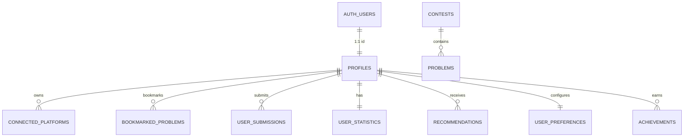

# Nexora Database Schema & Security Architecture

## 1. Overview
The Nexora database is built on PostgreSQL hosted via **Supabase**. It leverages **Supabase Auth** for identity management and **Row Level Security (RLS)** to enforce strict data isolation between competitive programmers.

All timestamps are stored in UTC (`TIMESTAMPTZ`). UUIDs are used for primary identifiers of user-scoped entities, while natural composite/slug identifiers are used for platform entities (e.g., `cf-1950` for Codeforces contests).

---

## 2. Entity Relational Diagram (Logical)

---

## 3. Tables Specification

### 3.1. `profiles`
Extends `auth.users` with competitive programmer profile information.

| Column | Type | Constraints | Description |
|---|---|---|---|
| `id` | `UUID` | `PRIMARY KEY`, `REFERENCES auth.users(id) ON DELETE CASCADE` | Auth user ID |
| `username` | `TEXT` | `UNIQUE NOT NULL` | Unique user handle |
| `display_name` | `TEXT` | | User display name |
| `email` | `TEXT` | | Account email |
| `avatar_url` | `TEXT` | | Avatar or Gravatar URL |
| `bio` | `TEXT` | | Short bio |
| `created_at` | `TIMESTAMPTZ` | `DEFAULT NOW()` | Record creation timestamp |
| `updated_at` | `TIMESTAMPTZ` | `DEFAULT NOW()` | Last update timestamp |

### 3.2. `connected_platforms`
Maintains verified handles and synced ratings for external coding platforms.

| Column | Type | Constraints | Description |
|---|---|---|---|
| `id` | `UUID` | `PRIMARY KEY DEFAULT gen_random_uuid()` | Internal ID |
| `user_id` | `UUID` | `NOT NULL REFERENCES profiles(id) ON DELETE CASCADE` | Owner ID |
| `platform` | `TEXT` | `NOT NULL` (e.g. `'codeforces'`) | Platform name |
| `handle` | `TEXT` | `NOT NULL` | Handle on platform |
| `rating` | `INTEGER` | `DEFAULT 0` | Current rating |
| `max_rating` | `INTEGER` | `DEFAULT 0` | Peak rating achieved |
| `rank` | `TEXT` | `DEFAULT 'unrated'` | Current tier/rank title |
| `max_rank` | `TEXT` | `DEFAULT 'unrated'` | Peak tier/rank title |
| `is_verified` | `BOOLEAN` | `DEFAULT TRUE` | Verification flag |
| `last_synced_at` | `TIMESTAMPTZ` | | Last API sync time |
| `created_at` | `TIMESTAMPTZ` | `DEFAULT NOW()` | Connection time |

*Constraint*: `UNIQUE(user_id, platform)` prevents duplicate platform entries for a single user.

### 3.3. `contests`
Public cache of upcoming, active, and past competitive programming contests.

| Column | Type | Constraints | Description |
|---|---|---|---|
| `id` | `TEXT` | `PRIMARY KEY` (e.g. `'cf-1950'`) | Unique contest key |
| `platform` | `TEXT` | `NOT NULL DEFAULT 'codeforces'` | Hosting platform |
| `platform_contest_id` | `INTEGER` | `NOT NULL` | Platform's native contest ID |
| `name` | `TEXT` | `NOT NULL` | Contest title |
| `type` | `TEXT` | `DEFAULT 'CF'` | Contest type |
| `phase` | `TEXT` | `NOT NULL` | `'BEFORE'`, `'CODING'`, `'FINISHED'` |
| `duration_seconds`| `INTEGER` | `NOT NULL` | Length of contest in seconds |
| `start_time` | `TIMESTAMPTZ` | `NOT NULL` | Contest start time |
| `website_url` | `TEXT` | | Direct contest URL |
| `synced_at` | `TIMESTAMPTZ` | `DEFAULT NOW()` | Cache timestamp |

### 3.4. `problems`
Public catalog of competitive programming problems.

| Column | Type | Constraints | Description |
|---|---|---|---|
| `id` | `TEXT` | `PRIMARY KEY` (e.g. `'cf-1950-A'`) | Platform-prefixed ID |
| `contest_id` | `INTEGER` | | Associated contest ID |
| `index` | `TEXT` | `NOT NULL` | Problem index (e.g. `'A'`, `'B'`) |
| `name` | `TEXT` | `NOT NULL` | Problem title |
| `type` | `TEXT` | `DEFAULT 'PROGRAMMING'` | Problem type |
| `rating` | `INTEGER` | | Difficulty rating (e.g. 800 - 3500) |
| `tags` | `TEXT[]` | `DEFAULT '{}'` | Array of topic tags (dp, graphs, math) |
| `platform` | `TEXT` | `NOT NULL DEFAULT 'codeforces'` | Source platform |
| `url` | `TEXT` | | Official problem link |
| `synced_at` | `TIMESTAMPTZ` | `DEFAULT NOW()` | Cache update time |

### 3.5. `bookmarked_problems`
User-saved problems for targeted study or review.

| Column | Type | Constraints | Description |
|---|---|---|---|
| `id` | `UUID` | `PRIMARY KEY DEFAULT gen_random_uuid()` | Bookmark ID |
| `user_id` | `UUID` | `NOT NULL REFERENCES profiles(id) ON DELETE CASCADE` | User ID |
| `problem_id` | `TEXT` | `NOT NULL` | Problem ID reference |
| `title` | `TEXT` | `NOT NULL` | Problem title |
| `platform` | `TEXT` | `NOT NULL DEFAULT 'codeforces'` | Platform |
| `rating` | `INTEGER` | | Difficulty rating |
| `tags` | `TEXT[]` | `DEFAULT '{}'` | Problem tags |
| `url` | `TEXT` | | Problem URL |
| `notes` | `TEXT` | | Personal user notes |
| `created_at` | `TIMESTAMPTZ` | `DEFAULT NOW()` | Bookmark timestamp |

*Constraint*: `UNIQUE(user_id, problem_id)` prevents duplicate bookmarks.

### 3.6. `user_submissions`
Synchronized submission history from Codeforces API.

| Column | Type | Constraints | Description |
|---|---|---|---|
| `id` | `UUID` | `PRIMARY KEY DEFAULT gen_random_uuid()` | Internal ID |
| `user_id` | `UUID` | `NOT NULL REFERENCES profiles(id) ON DELETE CASCADE` | User ID |
| `platform` | `TEXT` | `NOT NULL DEFAULT 'codeforces'` | Platform |
| `platform_submission_id` | `BIGINT` | `NOT NULL` | Official submission ID |
| `problem_id` | `TEXT` | `NOT NULL` | Problem reference |
| `problem_name` | `TEXT` | `NOT NULL` | Problem title |
| `verdict` | `TEXT` | `NOT NULL` | Verdict (`'OK'`, `'WRONG_ANSWER'`) |
| `language` | `TEXT` | | Programming language |
| `passed_test_count` | `INTEGER` | `DEFAULT 0` | Test cases passed |
| `time_consumed_ms` | `INTEGER` | `DEFAULT 0` | Execution time |
| `memory_consumed_bytes` | `BIGINT` | `DEFAULT 0` | Memory consumed |
| `submitted_at` | `TIMESTAMPTZ` | `NOT NULL` | Submission timestamp |
| `created_at` | `TIMESTAMPTZ` | `DEFAULT NOW()` | Ingestion timestamp |

### 3.7. `user_statistics`
Aggregated metrics to power the mobile dashboard and analytics with zero latency.

| Column | Type | Constraints | Description |
|---|---|---|---|
| `id` | `UUID` | `PRIMARY KEY DEFAULT gen_random_uuid()` | Record ID |
| `user_id` | `UUID` | `NOT NULL REFERENCES profiles(id) ON DELETE CASCADE UNIQUE` | User ID |
| `total_solved` | `INTEGER` | `DEFAULT 0` | Total accepted problems |
| `easy_solved` | `INTEGER` | `DEFAULT 0` | Rating < 1200 |
| `medium_solved` | `INTEGER` | `DEFAULT 0` | 1200 <= Rating <= 1600 |
| `hard_solved` | `INTEGER` | `DEFAULT 0` | Rating > 1600 |
| `current_streak` | `INTEGER` | `DEFAULT 0` | Consecutive days with AC |
| `max_streak` | `INTEGER` | `DEFAULT 0` | Longest streak |
| `contests_participated`| `INTEGER` | `DEFAULT 0` | Rated contests attended |
| `last_active_date` | `DATE` | | Last active day |
| `updated_at` | `TIMESTAMPTZ` | `DEFAULT NOW()` | Last update time |

### 3.8. `recommendations`
Stores personalized AI problem recommendations generated by Gemini API.

| Column | Type | Constraints | Description |
|---|---|---|---|
| `id` | `UUID` | `PRIMARY KEY DEFAULT gen_random_uuid()` | Recommendation ID |
| `user_id` | `UUID` | `NOT NULL REFERENCES profiles(id) ON DELETE CASCADE` | Target user ID |
| `problem_id` | `TEXT` | `NOT NULL` | Recommended problem ID |
| `problem_title` | `TEXT` | `NOT NULL` | Problem title |
| `platform` | `TEXT` | `NOT NULL DEFAULT 'codeforces'` | Platform |
| `suggested_difficulty`| `TEXT` | | e.g. `'Easy-Medium'`, `'Targeted Practice'` |
| `suggested_rating` | `INTEGER` | | Target rating |
| `topic` | `TEXT` | | Focus algorithmic area |
| `reason` | `TEXT` | `NOT NULL` | AI explanation for recommendation |
| `practice_sequence` | `INTEGER` | `DEFAULT 1` | Sequence in roadmap |
| `is_completed` | `BOOLEAN` | `DEFAULT FALSE` | Solved flag |
| `created_at` | `TIMESTAMPTZ` | `DEFAULT NOW()` | Generation timestamp |

### 3.9. `user_preferences`
User custom settings for theming and alerts.

| Column | Type | Constraints | Description |
|---|---|---|---|
| `id` | `UUID` | `PRIMARY KEY DEFAULT gen_random_uuid()` | Preference ID |
| `user_id` | `UUID` | `NOT NULL REFERENCES profiles(id) ON DELETE CASCADE UNIQUE` | Owner ID |
| `theme` | `TEXT` | `DEFAULT 'dark'` | `'dark'`, `'light'`, `'system'` |
| `notifications_enabled`| `BOOLEAN` | `DEFAULT TRUE` | Global alerts |
| `contest_reminders` | `BOOLEAN` | `DEFAULT TRUE` | Contest alerts |
| `default_platform` | `TEXT` | `DEFAULT 'codeforces'` | Default tab filter |
| `preferred_difficulty_min` | `INTEGER` | `DEFAULT 800` | Lower practice bound |
| `preferred_difficulty_max` | `INTEGER` | `DEFAULT 1600` | Upper practice bound |
| `updated_at` | `TIMESTAMPTZ` | `DEFAULT NOW()` | Update timestamp |

### 3.10. `achievements`
Gamification badges awarded based on milestones.

| Column | Type | Constraints | Description |
|---|---|---|---|
| `id` | `UUID` | `PRIMARY KEY DEFAULT gen_random_uuid()` | Achievement ID |
| `user_id` | `UUID` | `NOT NULL REFERENCES profiles(id) ON DELETE CASCADE` | User ID |
| `badge_key` | `TEXT` | `NOT NULL` | e.g. `'first_ac'`, `'streak_7'` |
| `badge_name` | `TEXT` | `NOT NULL` | Friendly name |
| `description` | `TEXT` | `NOT NULL` | Criteria description |
| `icon_name` | `TEXT` | `DEFAULT 'trophy'` | Vector icon key |
| `unlocked_at` | `TIMESTAMPTZ` | `DEFAULT NOW()` | Unlock timestamp |

---

## 4. Row Level Security (RLS) Matrix

| Table | SELECT | INSERT | UPDATE | DELETE |
|---|---|---|---|---|
| `profiles` | Public (`true`) | Owner (`auth.uid() = id`) | Owner (`auth.uid() = id`) | Denied |
| `connected_platforms`| Public (`true`) | Owner (`auth.uid() = user_id`) | Owner (`auth.uid() = user_id`) | Owner (`auth.uid() = user_id`) |
| `contests` | Public (`true`) | Authenticated users | Authenticated users | Admin only |
| `problems` | Public (`true`) | Authenticated users | Authenticated users | Admin only |
| `bookmarked_problems`| Owner (`auth.uid() = user_id`)| Owner (`auth.uid() = user_id`) | Owner (`auth.uid() = user_id`) | Owner (`auth.uid() = user_id`) |
| `user_submissions` | Public (`true`) | Owner (`auth.uid() = user_id`) | Owner (`auth.uid() = user_id`) | Owner (`auth.uid() = user_id`) |
| `user_statistics` | Public (`true`) | System Trigger | Owner (`auth.uid() = user_id`) | Denied |
| `recommendations` | Owner (`auth.uid() = user_id`)| Owner (`auth.uid() = user_id`) | Owner (`auth.uid() = user_id`) | Owner (`auth.uid() = user_id`) |
| `user_preferences` | Owner (`auth.uid() = user_id`)| Owner (`auth.uid() = user_id`) | Owner (`auth.uid() = user_id`) | Denied |
| `achievements` | Public (`true`) | Owner (`auth.uid() = user_id`) | Denied | Denied |
